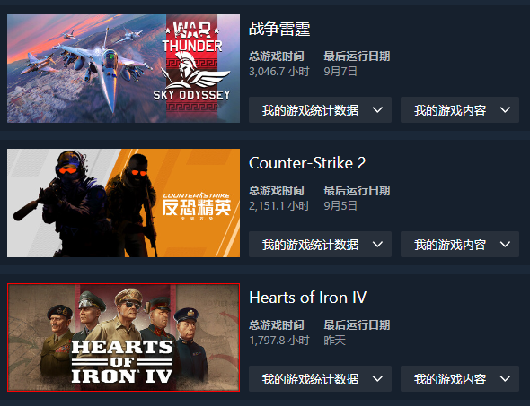

## 社团

我加入了智能车社团。虽然打比赛可能会很艰辛，不过这条路先走再说。 

校赛的竞争看来是十分激烈了，就连144k和12k的单片机也需要抢。我不知道我能不能追上那些大手子的进度，总之尽力就行。（明明应该是做好自己的事啊喂，可是资源有限，竞争的存在是实打实的，双手一摊.jpg）

不过每个人的起点好像已经拉开了差距，有的人正式开学才7天，就已经学到了c语言的指针，而有的人还缺乏对计算机使用的知识。（不对这两者好像并没有什么关系，总是就是这样了w） 

祝我好运。

### 关于Robotmaster

我暂时放弃了。精力实在有限，身体不允许我这么做。我已经看到有人双修智能车和rm了，佩服他的精力。

## 学习

我不理解一件事，为什么大学了会有早自习的出现，尤其还是强制的。如果你是去了能加学分我还能够理解一点，但是不去就扣分是什么意思呢。一定要摧毁我的睡眠时长吗。

## 时间都去哪了

我对时间的利用率实在低的吓人。完全不知道自己在忙点什么，如此之多的空余时间却没有怎么推进我的任务，这很坏。 

我觉得我可能是太放松了，喜欢在做事之前搞一点准备工作，明明直接去做就好了。 

吃饭时看手机，没有把时间挤出来给到我的想要做的事情，水课也没有好好利用起来（我觉得这是重点） 

总之努力改变吧！

## 偿不完的债

我的身体好像废了。初中和高中的过分熬夜已经让我的寿命好像少了两年，晚上6点之后很难进入状态，8点之后更是无法进行任何学习了，只有困意。可我不想使用任何精神活性物质，我觉得这只会进一步恶化我的身体状况。我感觉我很可能做不到去实验室熬夜调车干活，身体会受不了的。我需要困告困告困告困告困告困告困告困告困告困告。

ps:至于为什么如此严重，原因如下↓

尤其是第一位，我现在觉得玩的久一点也不是好事，以前的不节制让我欠了无法衡量规模的身体债，却什么也没有得到。 

而且我现在已经陷入了极其严重的电子阳痿，我自2026年8月中旬开始就几乎没有怎么玩过游戏了，不想打开一点。（钢四的游玩是因为借号给发小了）

