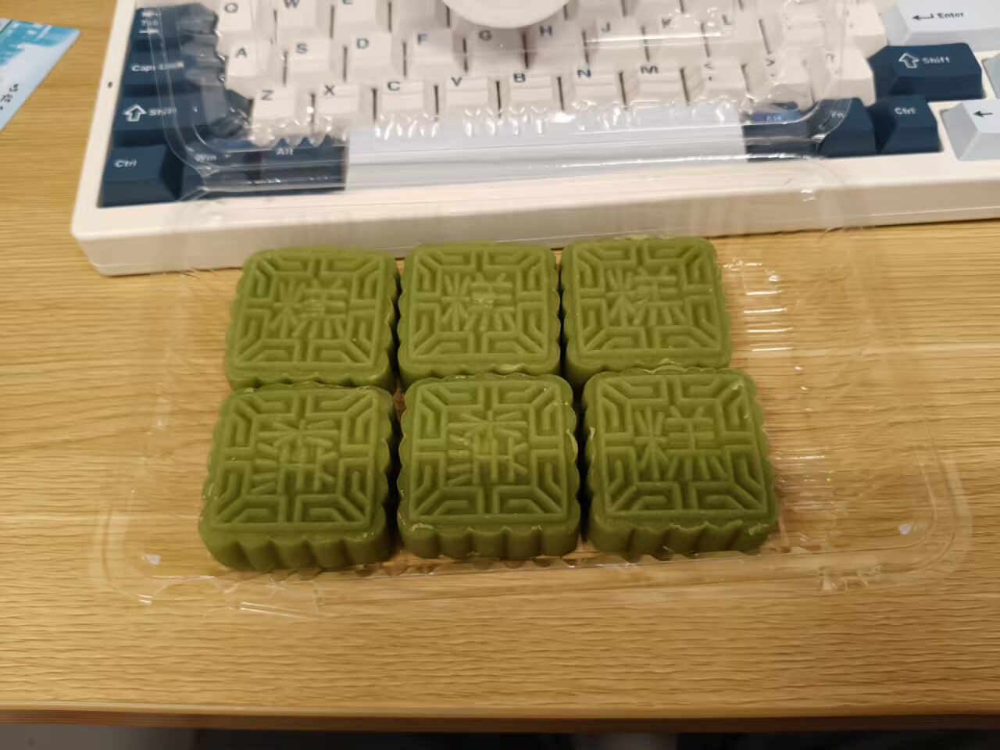

## 时间

时间好像开了加速器，明明什么都没做，没有学什么就要11月了。

我总会浪费我的时间。我明明有自己的主线任务做，但总是会忘记喵。。。

三万天本就不长，去做点有好处的事情喵。

要努力成为一个让自己满意的人喵。

### 我到底做了点什么呢

不知道喵。

好像把c推进到了指针，但是实际没怎么操练过，又忘记不少。

智能车呢？除了一堆毫无意义的commit，好像也什么都没有学到。

我到底在忙点什么？

高中有自己的主线任务，你不走也会被逼着走。但是这里不一样，没有人会管着你，没有什么可见的进度条，只有你自己一个人孤零零地站在这个好似人很多的学校。

## 社团

智能车社团好像还不错。最开始和我的一个初中同学来到了一个软件组，准备了两套代码。谁好就用谁的。不过最后是我败下阵来，所以以他的代码作为基础进行开发（sad）。

来调车的人数和当初来加入社团的人数好像对不上，不过我还是坚持下来了。

### 好像还不错

截止到10.23 已经有一个版本可以跑完所有环岛完赛了。不过我们好像并没有用什么有含金量的逻辑进行实现，所以其实是运气好？ 

应该还可以再完善一下w

### 为什么是ai军备竞赛

这是个很有意思的事情。在大家还没有怎么了解单片机的时候，每个人都掏出dsh和codex（我也在用w）只能说在传播焦虑这一块还是太权威了。

我觉得用agent作为学习手段可以，可是有的人好像不像来学习的。有一个大佬我很佩服的说，纯手写，调得又快又好。

### 坚持的意义是什么

我现在不知道我为什么我要为这个智能车社团相关的东西付出时间。投资好歹有可以量化的回报，但是这半个月忙下来，我认为我什么都没有学到。

或者说，我只是学了一点皮毛，连一点点知识点都算不上。

我就记得那个占空比了，别的毛也不记得，我也不知道自己在调车调点什么。

还稍微复习了一下git的东西，最开始我通过CLI去用git，现在也是。感觉改不掉了怎么办。

队友不会git，最基本的版本管理也不做，格式写的一大坨，没有看下去的欲望。

我好像暂时找不到参加的意义是什么。

## 我做的很烂

我在社交上做的很烂。 

很难想象我说实话，我作为一个十八岁的人，我居然不会关心别人。或者说我太笨拙了点，不理解什么是真正的关心别人。直到我问了发小是怎么做的，我才发现差距如此之大。  

社交太少是一个原因吧，天天和ai聊天把我自己聊的也失去人味了，我还是把ai当成工具比较好。 

## 记忆力

明显感觉到自己的记忆力衰退了，什么都记不住。暂时不知道有什么办法。

## 绿豆糕

我一直在找有没有什么甜而不腻的小甜品。终于让我发现了。来自袁式糕团

地址：上海市宝山区岭南路1026号

这个真的特别好吃。甜但是不腻，是那种独特的甘甜而不是像巧克力一样的齁甜。

所以给你吃一块www

## 题曲思维

直到现在我才意识到自己的题曲思维有多严重。潜意识里总是在做和别人比较的这种事，这种比较不是那种直接的比试，而是认为自己不够格。 

比如：我想要帮助他人，却会开始反思自己够不够格。有没有足够的能力和知识去帮助他人？“你懂吗你就去帮别人？”

我的神秘逻辑链：

别人学历高 / 做过的项目多 / 年纪比我大 = 比我有经验 = 帮助他人会显得我自己自以为是 = 嘉豪 = 不需要我的帮助

这几件事压根就没有任何联系。

而且 这件事所谓的「够格」没有任何标准。你无法证明自己够格，也无法证明自己不够格。

不是非得自己强于别人才能有资格帮助他人的。

那么有人要问了：ai这么发达了，还轮得到你去帮助他人吗，不是问问全知全能的ai大人就行了吗？

我觉得未必。有的时候人缺的不是问这件事本身，是根本没有任何 idea。

是因为根本想不到，所以提不出问题，进而即使ai大人全知全能也无法帮助到自身。

每一次有帮助他人的想法都会被我自己先批判一番，以至于不断思考想去我连主动发起帮助他人的行为的勇气都没有了。 

而且，别人的学历比我高、年纪比我大、做过更多的项目，不代表什么事情，任何方面都强于我。每个人都有自己的长板和短板，六边形战士几乎不可能存在。我是在和人交流，不是和ai交流。 

本质上帮助他人和自身有没有足够的能力没有半毛钱关系。哪怕你帮不上他人，你展示出来的帮助愿望也是能够让别人开心的。所以这件事完全就是自顾自地演一出内心戏罢了。怎么突然感觉想的太多也不是什么好事情？

而这种没有任何尽头的自我审判只会让我自己不断怯懦，退缩，不敢提出问题。最后只能独自面对一切。

我还是不想要这样子的生活的，因为我不是，也不可能是ai。

## 开心就好

我在上个月曾经对自己欠身体债这件事做了点批判，但是我要改变看法了。 

很难不承认，那段时间的疯狂让自己身体废了是事实。但是这何尝不是一种经历呢，人生是自己的，或许这种少有的快乐是我人生中独特的时光，大抵是有点无病呻吟了。

所以哪有那么多扯东扯西的事情，人生也不需要所有事都有意义来称陪。事已至此，开心就好，以后也是。

就是多做自己认为有意义，能让自己高兴的事就行了。

