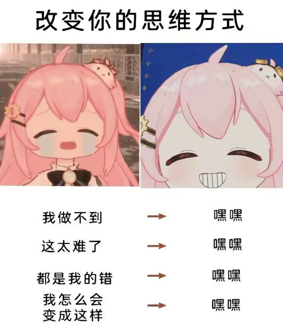

如果有人问我人生的意义是什么，我会回答以自己的主观感受为准。这可能是废话，但是好像很多时候并不是这样的。
我才活了18年，发表一点拙劣的理解吧。。。

## 做什么

我还是觉得做自己认为自己会快乐/能够沉浸的事情更对一点。

许多人焦虑，担忧，看短视频加剧焦虑，然后接着刷。有人抨击他们没有自制力，很多人连活下去都艰难，更不要说做一些事情来规范自己，然后探究生命活下去的意义了。这是不是何不食肉糜呢，我不知道，也不重要。

我觉得我要多做让我自己快乐的事情，把判断标准从外部抢回来，从股票市场到现实生活中的交流中我感觉都是这样，真理有可能都掌握在少数人中，至于自己是不是那个少数人，不重要，做好自己就行了。一旦你认为自己是掌握真理的少数人，那你就不是掌握真理的少数人。

## 焦虑

一些视频就是典型的宣扬焦虑，反倒是这些视频流量最高，比如什么情感博主：“xxx行为就是不爱你”“以下行为做了就是扣分项”，轻而易举地把一个人的社交行为量化成一个分数，然后用一些手法来通用地对待他人，到底是何意味？我们之所以是人，就是因为每个人都不一样，这么做除了博眼球和流量我找不到意义。

还有一些比如学习博主“这个不学就晚了跟不上时代”“赢在起跑线”之类的视频，又是一个典型。

从小时候，比如经典的初高中，这些时候就是宣扬焦虑最有效的时候。

作为被灌输焦虑的人，当了父母又作为给他人灌输焦虑的人。这实在是太荒谬，太奇异搞笑了。

还有所以我们面对焦虑的时候，可以想一想两个问题。一个是某人人宣扬焦虑的动机是什么，对他自己有什么好处？是为了流量还是为了卖给你课呢。一个是这种焦虑有没有必要，是什么无比重要的事情吗。

关注外部的评价重要吗，重要但也不重要。人说到底本质上还是个群居动物。可以参考/观察外部的评价，但是不能迎合外部评价。至于别人带来焦虑，恐慌，错失感都可以滚蛋了，反正我死不了。其实说回来了，还是要有一个精神内核吧，知道自己在做什么吧。

评价你，又与你何干？

还有有些话，比如"什么年纪你就该做什么样的事"，"你这么做不好，不对。"还有等等指导味道很重的话，先想想这件事真的是扯淡还是真的有好处吧。

## 😥

至于我的精神内核是什么，我不好说。现在应该是努力活下去做自己喜欢的事情。

只要你打心底里认为自己是一个善良，真诚的人，并且会吾日三省吾身一样反思自己做的事符不符合这样的标准。无论外界从物质条件上再到精神状态上把你贬的一文不值，其实不是很重要，你不会死。

有人问，我明明善良了，真诚了，为什么我还是没有变好，没有获得该有的地位。我觉得这两者从最开始是没有什么联系的。但是你有了地位之后真诚也许是在一些情况下的加分项。

相信自己就行，我是要减少吃畏手畏脚的亏了。

最后，我这样的内容算不算另类的宣扬焦虑，有可能算吧，所以我的观点也不重要，这就是个参考，如果我宣扬了焦虑，把他吐掉就行。

所以活下去喵，记得每天摄入两千大卡，8杯水和9h睡眠喵。

## 😪

哦对了，关于AGI取代人类工作这件事。我觉得没有调查就没有发言权。
真的能够取代吗，我自己是不太看好的，就算真的有AGI还要考虑成本问题，5-10年实现的概率我觉得不大。