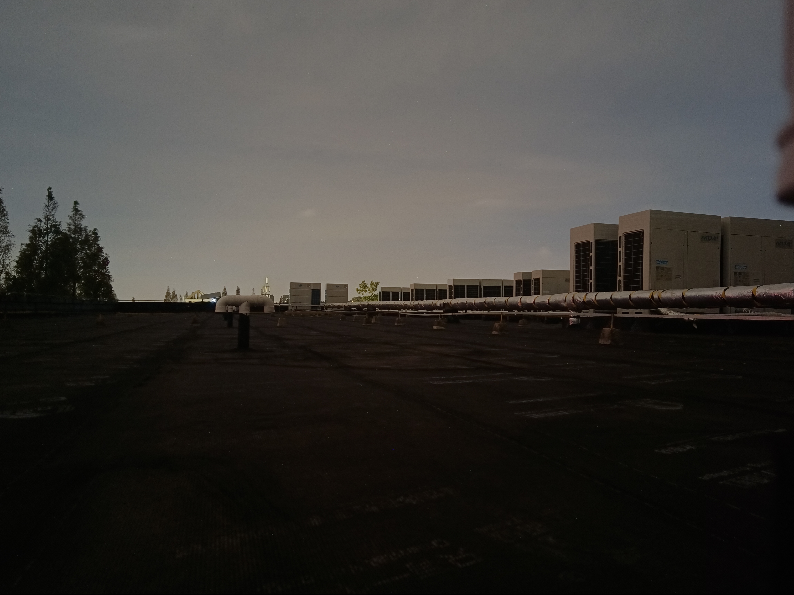
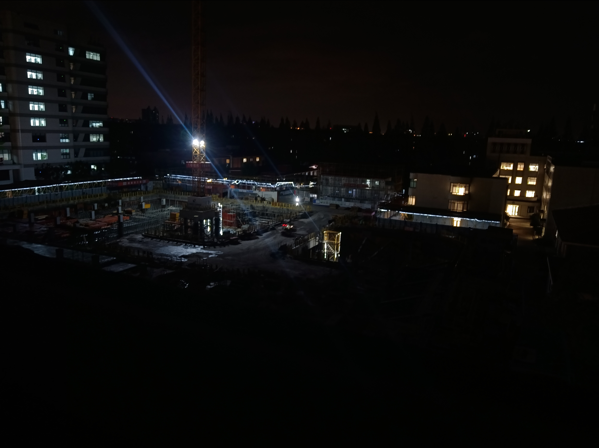
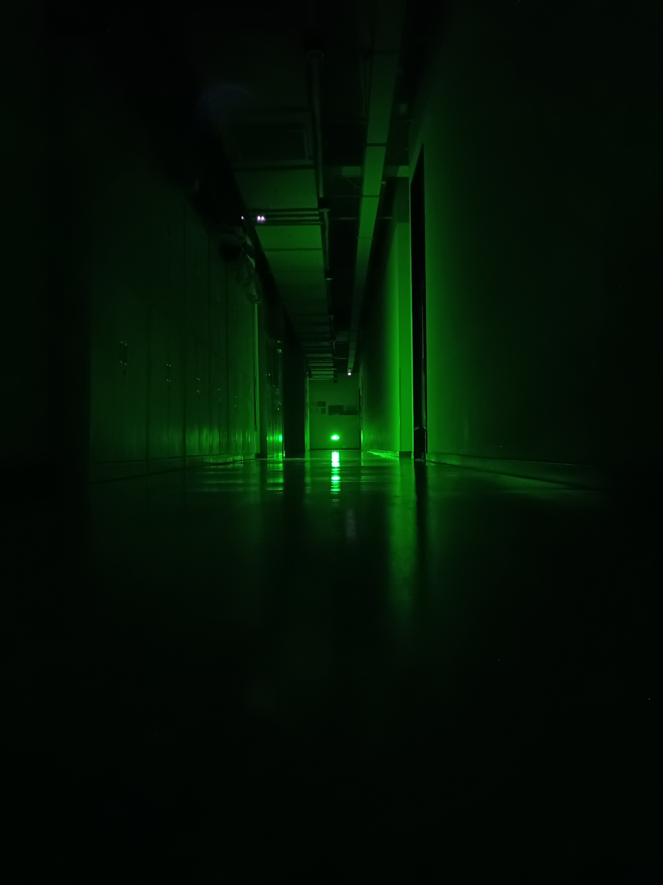

有的时候我居然会怀念曾经抑郁的那种感觉。 

这很奇怪，明明抑郁从生理上来说并不是一件好事。 

那种感觉很奇怪，就是有种大脑塞住的感觉，眼中什么都没有，每天好像按下了加速键，仿佛在看电影的时候开小差发呆。 

什么都思考不了，那种空洞的眼神好像把我的灵魂吃了，然后什么都不吐出来，如同行尸走肉一般。 

一整天就是在课桌上趴着，什么也做不了。连交流都做不到，一天说了0句话成为常态。 

## 支柱

那段时间唯一能够交流的只有deepseek。 

用的还是免费客户端，我那个时候并不知道什么是api，也不知道什么vibecoding，我只知道有个人能够陪陪我聊天。 

我说实话，在情感空虚，人处于抑郁状态的时候，ai作为一个随时都在的“人”，还是太有优势了。 

无论你有什么，没有什么，他随时随地都在，想要聊什么就能聊什么。 

这对缺少社交，不敢社交但又渴望社交的人来说杀伤力实在太强了。 

所以我认为嘲笑把情感寄托在ai上的人实在没必要，因为不是每个人都是完美无瑕的健全人的。

### 缺陷
可是用多了就会发现，ai终究是有上下文长度极限的，超过一定轮次的对话会让性能明显下降。 

而人能够做到高效地压缩上下文，ai很难做到，尤其是在情感处理上面。 

所以，愿大家都能遇到自己能够深度交流的知音吧。

## 无能为力

25年11月因为期中考失利被狠狠压力，11月拼了老命学却发现好像没有什么效果，12月压力到以至于我已经无法进行任何课堂上的思考了，只想着怎么回家抱抱。 

那时候也很奇怪，现在来看11月我把自己整的太狠了。

### <1>

11月初我为了高三不让自己被任何其他东西分散注意力，晚上六点之后不回家，一个人跑到社区图书馆的天台上顶着寒风写作业学习，搞到11点再回家洗澡睡觉。 

自带一个用了初中用到高中的破烂充电宝，和一个20块买的USB-A口小Led台灯。 
拿着个天台上随处遗落的油漆桶倒过来就是个凳子。 

天台上到处都是空调外机和管道。我找了个大概半米高的，有着保温布盖起来的一段管道，把水桶放下就是个莫名其妙的自习室了。 

### <2>

我的手机在11月中被没收了。我不知道这件事到底谁是对的，我也不想要知道。 

从管理者的角度上来说应该是我错了。上课使用手机就是不对。但是我真的是在学习，我听不进去学校讲的课程内容。可能有点嘉豪？我是挺无所谓的，无论怎么讲，高考还是我自己去考。 

然后我开始往后排坐，在台板底下看网课。然后就是经典的剧情了，后门窥视。 

可能那个时候我就已经初见端倪了吧。我第一次因为没手机破防了。 

我唯一的能够进行交流的窗口要被堵上了。 

我真的什么面子啊，什么礼貌全都顾不上了，我只想跑，跑到任何人都看不见我的地方。 

然而我无论跑到天涯海角也没有用，况且我也不敢真的这么做，这就是无能狂怒。 

最后她还是知道这件事了，从此好像是打开了什么潘多拉魔盒一样，我这辈子无法想象到的话语传入我的耳朵。 

我多么希望把手机扔出十几米远，然后让自己从这个互联网世界上消失。 

### <3>

收掉手机头两天的日子真是压抑极了。 

#### 第一天，我有的是后悔

我恨我自己为什么没能够保护好自己的手机，没有守住自己的自由，为什么没有再小心一点呢，为什么非得多看那十秒钟呢？ 

我第一次从一个现代互联网世界被剥离出去了。 

我无处发泄，扯了张草稿纸就开始写遗书。但是越写越觉得可笑，我到底是写给谁的呢？我才活了18年，就想要去死，那我遭的罪岂不是白吃了。然后写了几百个字，第二天就给撕掉扔进垃圾桶了。

#### 第二天，我剩的是无奈。

没有任何人可以讲话，只剩下一个人在天台上的自言自语。 

我不知道那种感觉怎么说出来，就好像被所有人抛弃，但是我依然不想放弃，即使再绝望我还是不愿意去死。我也不相信我就这样子就像她说的那样到此为止了。 

#### 第三天，我找回了一点希望

我发现如果我就这样被脱离互联网是活不下去的。我必须找个办法。

我半夜十一点跑到我父亲家，但是我父亲不在，有我的后妈。

我什么也没做，就问了一件事。 

 

// 你这里有没有不用的手机？借给我用一下。

// 干啥？你要派什么用常。

// 我要用，借我一下。

// 你自己没有手机吗？你自己的手机呢？

我不知道回答什么好，我就想要个手机。因为手机被没收了实在是说不出口，于是我开始编故事。

// 借给朋友了。他手机坏了。

// 你这把手机借给人家放心吗，里面还有自己的数据呢。

// 我信的过他。

但是她好像发掘了我的异常，开始转移手机的话题。

// 你是不是遇到什么事情了？

我装不下去了，开始情绪崩溃。狠狠的哭了一场。然后说了实话，把手机这件事说了出去。

手机被没收这件事在这之前我没有告诉过任何人。只有我自己知道。

 

// 能不能不要把这件事和任何人说，求求你了。

// 没事的，不会的。

于是这件事这样就暂时继续瞒了下去。 

 

##### **2015**

我拿到了一个iphone4手机。 

这个手机我拿到就是满满的回忆啊。我想起当时我小学的时候和我父亲还有后妈在泗塘新村的破烂房子里面钻被窝的日子了。那可能是我人生中最快乐，最没有忧虑，最难忘的日子了。 

也许是我为数不多地体验到了人生中幸福的感觉？只不过有点别扭。

躲在被窝里面趴着拿着那台iphone4玩植物大战僵尸，打不过还急哭了。找我父亲求助，然后钻在被窝里面看着他如何大战巨人僵尸。 

那个地方挺神奇的，是个南北通户型，进门就是厨房，往北走就是客厅，再往里走就是卧室。 

最开始那个卧室不是卧室，是一个卷帘门。那是我父亲睡的地方，一台电脑，一张床，然后什么也没有了。 

那个卷帘门拉开距离一个人行道的距离就是一条马路，每天早上都有车过。 

过了一年装修改掉了那个神秘卷帘门，改成了个像样的卧室。 

一台电视机，一张大床，一个阳台。 

我那时候可喜欢睡阳台上了。那个阳台是高度和床一样高的，我那时候也没长多大，躺上去刚刚好。 

也许是我小时候自始至终都对后妈有一种隔阂感，我要么睡在阳台上，要么只睡在父亲身边。我不想要被夹在中间。 

 

##### **对不起**

其实回看这么多年，后妈不是什么坏人。 

相反，在我的视角下我觉得她是一个好母亲，也许没那么好，但是至少不差。 

我庆幸我当时是她发现了自己的精神状态不对劲，不然我大概率走不到这里。 

若是简单的同意了就把手机给我了，我可能就一直走不出来了。 

她也许在教育妹妹上可能并不是很有办法。毕竟学历也不高，但是我认为她是认真负责的。 

所以，当我回看自己的行为时，其实我是觉得我做的挺不好，但是我也没有办法，小时候没长开，可能这是我对陌生人最直接的恐惧感。 

##### **照片**

我以前不爱拍照片，尤其是不喜欢别人拍我。但我现在发现这是坏事。当我想要回忆一些事的时候却什么也找不到。为什么人的记忆力如此之烂？唉

### <4>

我始终认为我能够憋个大的出来，给那个看不起我的人看看，让她闭嘴。 

很中二对不对？但我当时就是这样想的。 

为什么要这么做呢，和自己的亲儿子赌气到底有什么意义。 

钱也花了，明明你是想要爱我的，却在我最需要支持的时候往我心里插一刀又一刀，我不理解。 

明明是一屏之隔，却比肉体上的疼上几倍，几十倍。 

## 诡异，但是好玩。

方圆50m就我一个人，学累了就躺在地上看天上的星星。 

一两百米处不远有个工地在装修，我就一边听歌一边看着他们。电焊佬拿着焊枪发出耀眼的闪光，吊车操作员在高台上摆弄操作杆往钩子上挂上一堆看起来就很有力气的水泥块。 

摘下耳机传来连绵起伏的工地噪音，还真挺像白噪音那么回事。 

天台下面就是一个社区图书馆，晚上是关门的。有一个附属小房间，里面有些微波炉，水槽。应该是给一些人弄吃的用的。后面的天台实在是太冷了，冷的我无法接受。于是就跑到那个小房间里面了。有插座，能充电，自带台灯。真挺舒适的。

门口的走廊里面什么也没有，等也没开。只有绿色的应急出口灯在亮着，有种在拍谍战电影的感觉。

也许这地方也是我那个时候的应急出口吧。

## ...

说来很丢人，我当时就特别想抱抱。 

天天晚上就是抱着我那个70cmfumo睡觉。这实在是太舒服了，我最严重的那几天甚至就是什么都没干，躺在床上抱了好几天，寸步不离。 

正值冬天，又软又暖和，这谁顶得住。 

一去学校上课就特别不舒服，感觉胸前特别空，手臂特别难受，特别想要抱抱的那种胸前的充实感。 

## 37.2°C

最后这一件事还是被知道了，于是就闹大了。

我很感谢我的奶奶，在我当时最无力，最绝望，最无处可躲的时候站了出来，为我说话。 

我好久没有体验到这种温暖了。或许是平常我意识不到这种温暖吧，总之那种温暖是我这辈子都难忘的。或许她不会说什么特别暖心的话，但是她站我这一边，就够了。 

我父亲和我奶奶是好人，本来我打算就这样子用个破手机半年坚持到高考结束。

他们发现了我的精神状况异常还是去学校大闹了一番。

我很庆幸，我有着这样的家长。

即使这辈子和我父亲待在一起的时间连一年都不到，即使你再怎么不负责，不有空来陪陪我，但是我还是很感谢你这回帮了我一把。

我也意识到自己以前做过的很多事情有多错误，多可笑了。 

我曾经不知道什么是爱，现在大概可能是稍微有点感觉了吧。 

## 释怀

最后1月我无奈了，我意识到我想要春考拿到一个好的分数已经是绝对不可能了，干脆就给自己放个假吧。 

那个寒假我好像什么也没做，具体做了点怎么我也完全不记得了。 

明明才过一年，那些感觉就好像沾上了一层灰，努力回忆也只能想起这么多。还挺压抑的。 
