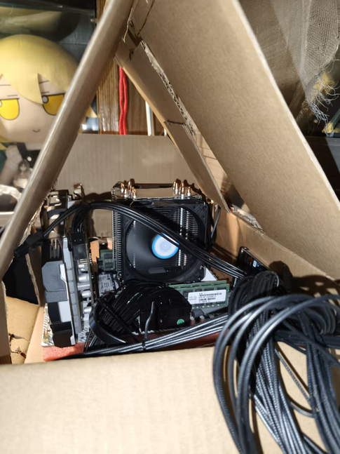
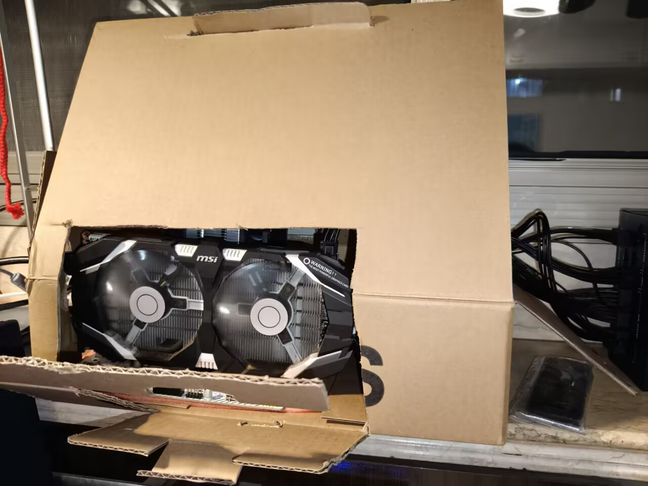

**CPU：** Intel E5-2689B v3 [16C/32T]

**GPU：** GTX 2060 [6GB]

**主板：** 精粤 X99M-G D3

**内存：** 三星 型号我不知道哈哈 DDR4 **x4** [16GB] [1866Mhz] [ECC]

**SSD：** Kingston 型号还是不知道哈哈 1T

**HDD：** 希捷 1T

**散热：** 50块六热管

**屏幕：** HKC IG27QK [2K] [240Hz] [Fast IPS] [27″] 

 

 

 

都怪内存涨价，考虑到后面有跑仿真的需求，加上我想当现金仓鼠，选择了2026年很具性价比的x99系列。

很有趣的是，这台电脑的只有主板，cpu和内存是我实际花费资金购买的，其他都是从以前不用的机器上拆下来的。回收这一块。

这台电脑将会作为我的宿舍主力机使用。

很抽象的是，由于我懒得买机箱和整理电线，我diy了一个纸盒子来当作机箱。

花费了珍贵的30分钟，先凑合着吧，就这样。
